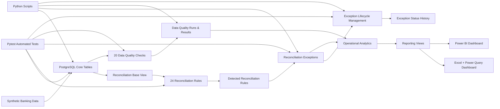
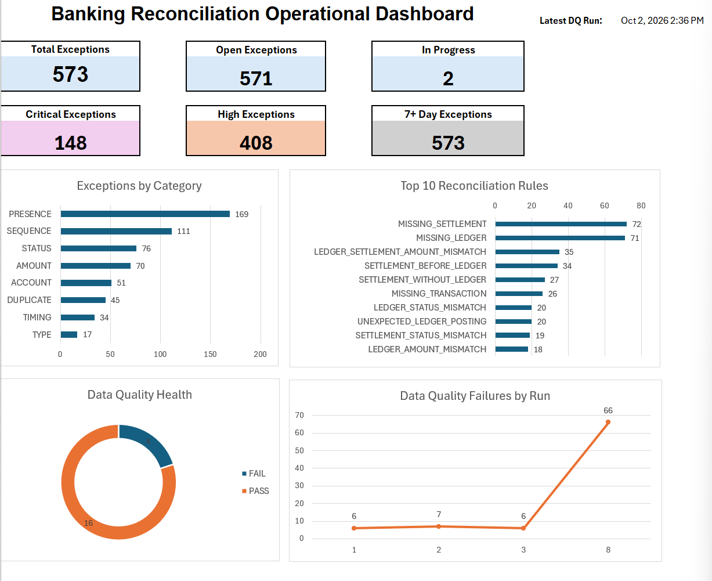
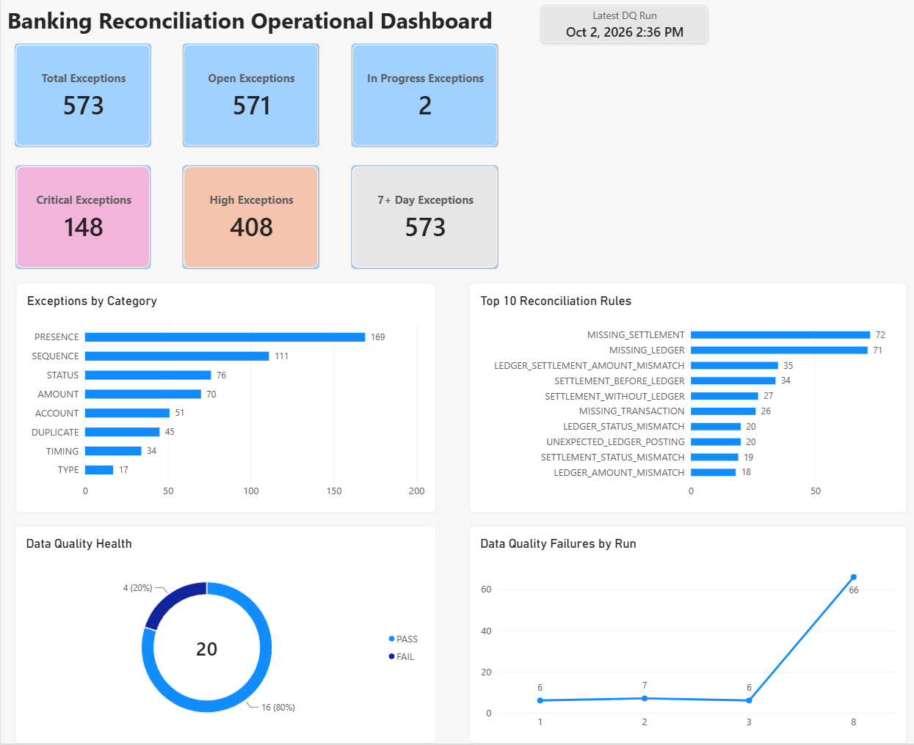
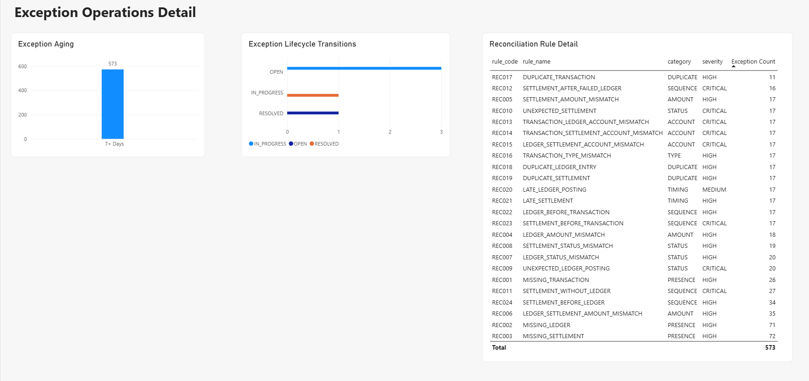
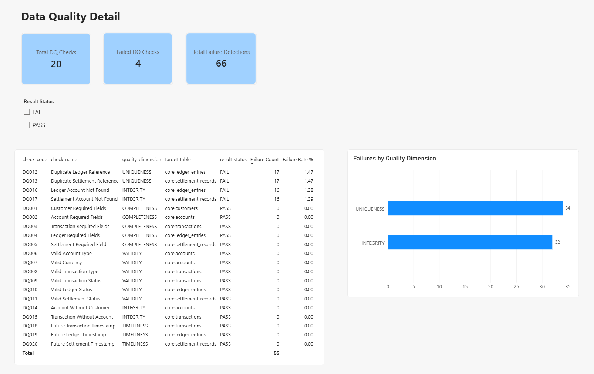
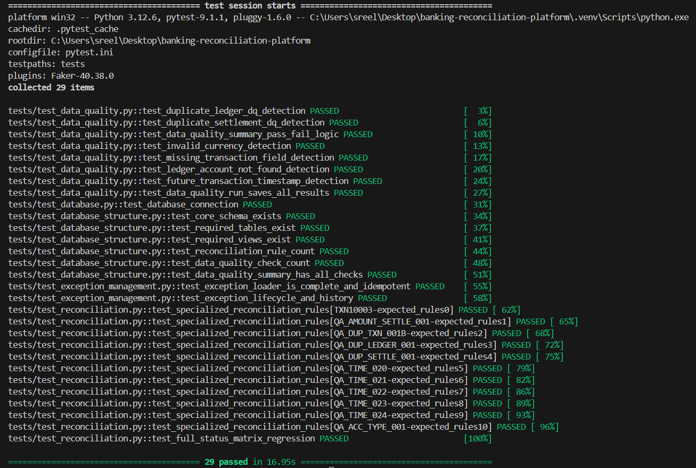

# Banking Transaction Reconciliation & Data Quality Platform

An end-to-end banking operations platform that reconciles transaction, ledger, and settlement data; detects reconciliation exceptions and data-quality issues; manages exception lifecycle transitions; validates the platform with automated Pytest coverage; and delivers operational reporting through Excel and Power BI.

The project is designed to simulate a real-world banking reconciliation workflow where multiple systems must agree on transaction presence, amounts, statuses, account information, sequencing, and timing.

## Key Capabilities

- Reconciles transaction, ledger, and settlement systems
- Implements 24 reconciliation rules across presence, amount, status, sequence, account, type, duplicate, and timing checks
- Detects and persists reconciliation exceptions automatically
- Supports exception lifecycle management: `OPEN`, `IN_PROGRESS`, and `RESOLVED`
- Tracks exception status history
- Runs 20 automated data-quality checks across completeness, validity, uniqueness, integrity, and timeliness
- Generates synthetic banking data with controlled anomaly scenarios
- Validates database structure, reconciliation logic, data quality, exception loading, and lifecycle behavior using Pytest
- Delivers operational analytics through PostgreSQL reporting views
- Provides refreshable Excel and Power BI dashboards

## Tech Stack

### Database & SQL

- PostgreSQL
- Advanced SQL
- Views, CTEs, joins, aggregations, and exception-detection logic

### Python

- Python
- Pandas
- Psycopg
- Faker
- python-dotenv

### Testing

- Pytest

### Reporting & BI

- Microsoft Excel
- Power Query
- Power BI
- DAX

### Version Control

- Git
- GitHub

## Architecture

The platform follows a layered design where PostgreSQL owns the core reconciliation and data-quality logic, Python handles data generation and operational workflows, Pytest validates expected behavior, and Excel and Power BI consume reporting views for analytics.



### System Flow

1. **Synthetic Data Generation**

   - Python generates customers, accounts, transactions, ledger entries, and settlement records.
   - Controlled anomaly scenarios are injected to simulate realistic reconciliation and data-quality failures.

2. **Core Banking Data Layer**

   - PostgreSQL stores transaction, ledger, and settlement data in the `core` schema.
   - Downstream ledger and settlement tables intentionally allow orphaned and duplicate records so reconciliation logic can detect them.

3. **Reconciliation Engine**

   - `core.reconciliation_base` aligns transaction, ledger, and settlement records using business reference numbers.
   - 24 reconciliation rules detect issues across:
     - Presence
     - Amount
     - Status
     - Sequence
     - Account
     - Transaction Type
     - Duplicate
     - Timing

4. **Exception Management**

   - Detected rules are loaded into `core.reconciliation_exceptions`.
   - Duplicate exception loading is prevented through idempotent insert logic.
   - Exceptions move through `OPEN`, `IN_PROGRESS`, and `RESOLVED` lifecycle states.
   - Status changes are captured in `core.exception_status_history`.

5. **Data Quality Engine**

   - 20 automated checks evaluate:
     - Completeness
     - Validity
     - Uniqueness
     - Integrity
     - Timeliness
   - Each run persists execution history and check-level results.

6. **Automated Testing**

   - Pytest validates database connectivity, schema structure, reconciliation behavior, rule coverage, data-quality logic, exception loading, idempotence, and lifecycle transitions.

7. **Reporting Layer**

   - PostgreSQL reporting views provide reusable operational summaries.
   - Excel connects through ODBC and Power Query.
   - Power BI connects directly to PostgreSQL and uses DAX measures for interactive reporting.

## Database Design

The project uses a PostgreSQL schema named `core` to separate the banking reconciliation domain from other database objects.

The data model represents three systems that must remain aligned:

- **Transaction System** — records the original banking transaction
- **Ledger System** — records the internal accounting entry
- **Settlement System** — records downstream settlement completion

These systems are intentionally not fully constrained by foreign keys at every stage because the reconciliation engine must be able to detect missing, orphaned, duplicated, and inconsistent records.

### Core Tables

#### `core.customers`

Stores customer information.

Key fields:

- `customer_id`
- `first_name`
- `last_name`
- `email`
- `date_of_birth`
- `created_at`

#### `core.accounts`

Stores banking accounts owned by customers.

Key fields:

- `account_id`
- `customer_id`
- `account_number`
- `account_type`
- `currency`
- `current_balance`
- `created_at`

Relationship:

`customers.customer_id → accounts.customer_id`

#### `core.transactions`

Represents the source transaction system.

Key fields:

- `transaction_id`
- `account_id`
- `reference_number`
- `transaction_type`
- `amount`
- `channel`
- `status`
- `transaction_time`

Relationship:

`accounts.account_id → transactions.account_id`

#### `core.ledger_entries`

Represents the internal ledger/accounting system.

Key fields:

- `ledger_entry_id`
- `transaction_reference`
- `account_number`
- `entry_type`
- `amount`
- `status`
- `posted_at`

Ledger records intentionally use the transaction reference as a business key without enforcing a foreign key to the transaction table.

This allows the platform to detect conditions such as:

- missing transactions
- duplicate ledger entries
- orphaned ledger records
- account mismatches
- amount mismatches

#### `core.settlement_records`

Represents downstream settlement processing.

Key fields:

- `settlement_id`
- `transaction_reference`
- `account_number`
- `settlement_amount`
- `settlement_status`
- `settlement_time`

Like the ledger table, settlement records intentionally allow records that may not have a valid matching transaction or ledger entry.

This enables detection of:

- missing settlements
- unexpected settlements
- settlement without ledger
- account mismatches
- timing and sequencing failures

### Business Relationships

```text
Customer
   ↓
Account
   ↓
Transaction
   ↓ reference_number
   ├──────────────→ Ledger Entry
   └──────────────→ Settlement Record
```

The `reference_number` acts as the main business reconciliation key between transaction, ledger, and settlement systems.

## Reconciliation Engine

The reconciliation engine compares transaction, ledger, and settlement records to detect operational mismatches across multiple banking systems.

A reusable PostgreSQL view, `core.reconciliation_base`, aligns records using the transaction `reference_number` and exposes the source-system values needed for rule evaluation.

The engine then evaluates 24 reconciliation rules and returns detected exceptions with:

- `reference_number`
- `rule_code`
- `variance`

Detected rules are persisted into `core.reconciliation_exceptions`.

### Reconciliation Rule Categories

The 24 rules are grouped into the following business categories:

- Presence
- Amount
- Status
- Sequence
- Account
- Transaction Type
- Duplicate
- Timing

### Reconciliation Rules

| Rule Code | Rule Name | Category | Severity |
|---|---|---|---|
| REC001 | MISSING_TRANSACTION | Presence | HIGH |
| REC002 | MISSING_LEDGER | Presence | HIGH |
| REC003 | MISSING_SETTLEMENT | Presence | HIGH |
| REC004 | LEDGER_AMOUNT_MISMATCH | Amount | HIGH |
| REC005 | SETTLEMENT_AMOUNT_MISMATCH | Amount | HIGH |
| REC006 | LEDGER_SETTLEMENT_AMOUNT_MISMATCH | Amount | HIGH |
| REC007 | LEDGER_STATUS_MISMATCH | Status | HIGH |
| REC008 | SETTLEMENT_STATUS_MISMATCH | Status | HIGH |
| REC009 | UNEXPECTED_LEDGER_POSTING | Status | CRITICAL |
| REC010 | UNEXPECTED_SETTLEMENT | Status | CRITICAL |
| REC011 | SETTLEMENT_WITHOUT_LEDGER | Sequence | CRITICAL |
| REC012 | SETTLEMENT_AFTER_FAILED_LEDGER | Sequence | CRITICAL |
| REC013 | TRANSACTION_LEDGER_ACCOUNT_MISMATCH | Account | CRITICAL |
| REC014 | TRANSACTION_SETTLEMENT_ACCOUNT_MISMATCH | Account | CRITICAL |
| REC015 | LEDGER_SETTLEMENT_ACCOUNT_MISMATCH | Account | CRITICAL |
| REC016 | TRANSACTION_TYPE_MISMATCH | Type | HIGH |
| REC017 | DUPLICATE_TRANSACTION | Duplicate | HIGH |
| REC018 | DUPLICATE_LEDGER_ENTRY | Duplicate | HIGH |
| REC019 | DUPLICATE_SETTLEMENT | Duplicate | HIGH |
| REC020 | LATE_LEDGER_POSTING | Timing | MEDIUM |
| REC021 | LATE_SETTLEMENT | Timing | HIGH |
| REC022 | LEDGER_BEFORE_TRANSACTION | Sequence | HIGH |
| REC023 | SETTLEMENT_BEFORE_TRANSACTION | Sequence | CRITICAL |
| REC024 | SETTLEMENT_BEFORE_LEDGER | Sequence | HIGH |

### Example Detection Logic

A missing-ledger condition is detected when a transaction exists but no corresponding ledger record is present.

Conceptually:

```sql
transaction exists
AND ledger entry is missing
→ REC002 MISSING_LEDGER
```

Amount mismatches use absolute variance comparisons, while sequence and timing rules compare transaction, posting, and settlement timestamps.

Multiple rules can be detected for the same transaction reference because each business rule is evaluated independently.

### Idempotent Exception Loading

Detected exceptions are inserted into `core.reconciliation_exceptions` using the unique combination:

```text
(reference_number, rule_code)
```

The loader uses conflict-safe insert logic so rerunning the reconciliation process does not create duplicate exception records.

This makes the exception-loading workflow idempotent and safe to rerun.

## Exception Lifecycle Management

Detected reconciliation exceptions are not treated as static records. The platform supports operational lifecycle management so exceptions can move through investigation and resolution states.

### Supported Statuses

Exceptions use three statuses:

- `OPEN`
- `IN_PROGRESS`
- `RESOLVED`

### Allowed Transitions

The lifecycle rules currently allow:

```text
OPEN → IN_PROGRESS
IN_PROGRESS → OPEN
IN_PROGRESS → RESOLVED
RESOLVED → OPEN
```

Invalid transitions are blocked by the Python lifecycle logic.

### Resolution Tracking

When an exception moves to `RESOLVED`:

- `resolved_at` is populated with the current timestamp.

If a resolved exception is reopened:

- the status returns to `OPEN`
- `resolved_at` is cleared.

### Status History

Every lifecycle change is written to:

`core.exception_status_history`

The history table stores:

- `history_id`
- `exception_id`
- `old_status`
- `new_status`
- `change_note`
- `changed_at`

This creates an audit trail of operational exception handling.

### Python Lifecycle Workflow

The lifecycle is managed through:

`src/update_exception_status.py`

The function:

```python
update_exception_status(exception_id, updated_status, change_note=None)
```

validates the requested transition, updates the exception record, manages the resolution timestamp, and inserts the corresponding status-history record.

### Example Lifecycle

```text
Exception detected
      ↓
OPEN
      ↓
IN_PROGRESS
      ↓
RESOLVED
```

If further investigation is required later:

```text
RESOLVED
    ↓
OPEN
```

This models a realistic operational exception-management workflow rather than simply detecting errors and leaving them untracked.

## Data Quality Engine

The platform includes a dedicated data-quality engine that evaluates the health of the banking dataset independently from reconciliation logic.

Reconciliation asks:

> Do the transaction, ledger, and settlement systems agree?

Data quality asks:

> Is the underlying data complete, valid, unique, referentially consistent, and timely?

The engine runs 20 automated checks across five quality dimensions.

### Data Quality Dimensions

- Completeness
- Validity
- Uniqueness
- Integrity
- Timeliness

### Data Quality Checks

| Check Code | Quality Dimension |
|---|---|
| DQ001–DQ005 | Completeness |
| DQ006–DQ011 | Validity |
| DQ012–DQ013 | Uniqueness |
| DQ014–DQ017 | Integrity |
| DQ018–DQ020 | Timeliness |

The checks evaluate conditions such as:

- missing required transaction fields
- invalid currencies or statuses
- duplicate ledger references
- duplicate settlement references
- invalid account references
- records that violate expected timing rules

### Data Quality Execution

Each execution creates a run record in:

`core.data_quality_runs`

Check-level results are stored in:

`core.data_quality_results`

Each result records whether the check:

- passed
- failed
- encountered an error

along with:

- rows checked
- failure count
- execution information

### Current Data Quality Snapshot

The current synthetic dataset produces:

- **20 total checks**
- **16 PASS**
- **4 FAIL**
- **66 total failure detections**

The failing checks are currently concentrated in duplicate and referential-integrity scenarios.

Examples include:

- duplicate ledger references
- duplicate settlement references
- ledger account references not found
- settlement account references not found

### Data Quality Reporting

The view:

`core.data_quality_summary`

provides the latest result for each configured check.

Additional reporting views expose:

- current DQ status
- failure counts
- failure rates
- historical DQ run trends

These views are consumed by Excel and Power BI for operational reporting.

## Synthetic Data & Controlled Anomalies

The project uses Python to generate a realistic synthetic banking dataset for testing reconciliation, data-quality, analytics, and reporting workflows.

Synthetic data generation is handled by:

`src/generate_synthetic_data.py`

### Generated Data

The generator creates records for:

- customers
- accounts
- transactions
- ledger entries
- settlement records

The dataset uses realistic Canadian-style synthetic values and banking attributes while avoiding real customer information.

### Controlled Anomaly Injection

The generator intentionally injects known anomaly scenarios so the reconciliation and data-quality engines can be validated against expected outcomes.

The project currently includes **19 controlled anomaly scenarios** covering cases such as:

- missing ledger records
- missing settlement records
- amount mismatches
- failed-status mismatches
- unexpected ledger postings
- unexpected settlements
- settlement without ledger
- account mismatches
- transaction-type mismatches
- duplicate transactions
- duplicate ledger entries
- duplicate settlement records
- late ledger posting
- late settlement
- ledger before transaction
- settlement before transaction
- settlement before ledger

### Why Controlled Anomalies Matter

Random data alone is not enough to validate a reconciliation engine.

Controlled anomalies provide a known test oracle:

```text
Injected condition
      ↓
Expected reconciliation rule
      ↓
Detected reconciliation rule
      ↓
Automated validation
```

This makes it possible to verify that the rule engine detects the correct exception for each known scenario.

### Larger Analytical Dataset

The synthetic dataset was expanded beyond the small controlled test cases so the reporting layer could support more realistic operational analytics.

This larger dataset is used to demonstrate:

- exception volumes
- severity distribution
- rule-level concentration
- category-level trends
- aging analysis
- data-quality failure counts
- historical DQ run trends

The same generated dataset supports PostgreSQL analytics, Excel reporting, Power BI dashboards, and automated regression testing.

## Automated Testing

The platform includes an automated Pytest suite that validates database connectivity, schema structure, reconciliation behavior, data-quality logic, exception loading, lifecycle management, and regression coverage.

The current test suite contains **29 tests**, all passing.

### Test Coverage

The test suite includes:

- database connection validation
- database structure validation
- reconciliation-rule validation
- full reconciliation status-matrix regression testing
- data-quality check validation
- DQ run persistence validation
- exception-loader completeness
- exception-loader idempotence
- lifecycle transition validation
- status-history validation
- resolved timestamp behavior
- invalid transition blocking

### Test Files

#### `tests/test_database.py`

Validates that the application can connect successfully to PostgreSQL.

#### `tests/test_database_structure.py`

Validates key database structures and expected objects.

#### `tests/test_reconciliation.py`

Tests reconciliation behavior using controlled fixtures and a full status matrix.

Coverage includes:

- specialized anomaly fixtures
- rule-to-scenario validation
- all observable transaction/ledger/settlement status combinations

#### `tests/test_data_quality.py`

Validates data-quality behavior, including:

- duplicate ledger references
- duplicate settlement references
- missing required transaction fields
- invalid currency values
- invalid account references
- future transaction timestamps
- DQ summary behavior
- DQ run persistence

Controlled test mutations are rolled back so the production-like synthetic dataset remains unchanged.

#### `tests/test_exception_management.py`

Validates:

- detected-rule loading into the exception table
- idempotent exception loading
- valid lifecycle transitions
- invalid lifecycle-transition blocking
- status-history creation
- `resolved_at` behavior
- test-record cleanup

### Regression Result

The full automated suite currently passes:

```text
29 passed
```

This provides regression protection across the reconciliation engine, data-quality engine, database structure, and exception-management workflow.

## Operational Analytics & Reporting Views

The platform includes a dedicated operational analytics layer in PostgreSQL so reporting tools can consume clean, reusable business summaries without duplicating reconciliation logic.

Operational analytics are implemented in:

- `sql/10_operational_analytics.sql`
- `sql/11_reporting_views.sql`

### Operational Analytics

The analytics layer provides summaries for:

- overall exception KPIs
- exception status and severity
- exceptions by reconciliation rule
- exceptions by business category
- exception aging
- lifecycle transition counts
- current data-quality status
- historical data-quality run trends

### Reporting Views

The following PostgreSQL views are exposed for Excel and Power BI:

- `core.exception_kpi_summary`
- `core.exception_rule_summary`
- `core.exception_category_summary`
- `core.exception_aging_summary`
- `core.exception_lifecycle_summary`
- `core.dq_current_summary`
- `core.dq_run_trend`

### Current Exception Snapshot

The current synthetic dataset produces:

- **573 total exceptions**
- **571 OPEN**
- **2 IN_PROGRESS**
- **0 RESOLVED**
- **148 CRITICAL**
- **408 HIGH**
- **17 MEDIUM**

### Exception Distribution by Category

Current exception counts by category include:

- Presence: **169**
- Sequence: **111**
- Status: **76**
- Amount: **70**
- Account: **51**
- Duplicate: **45**
- Timing: **34**
- Type: **17**

### Highest-Volume Reconciliation Rules

The highest-volume current rules include:

- `REC003 MISSING_SETTLEMENT` — **72**
- `REC002 MISSING_LEDGER` — **71**
- `REC006 LEDGER_SETTLEMENT_AMOUNT_MISMATCH` — **35**
- `REC024 SETTLEMENT_BEFORE_LEDGER` — **34**
- `REC011 SETTLEMENT_WITHOUT_LEDGER` — **27**
- `REC001 MISSING_TRANSACTION` — **26**

### Data Quality Reporting

The reporting layer also exposes:

- current PASS / FAIL status for each DQ check
- checked-row counts
- failure counts
- failure-rate percentages
- historical DQ run execution trends

This separation keeps business logic in PostgreSQL while allowing Excel and Power BI to focus on analysis, visualization, and interaction.

## Excel & Power BI Reporting

The reporting layer demonstrates how operational reconciliation and data-quality information can be consumed by business users through both Excel and Power BI.

### Excel Operational Dashboard

The Excel report is stored at:

`reports/Banking_Reconciliation_Operational_Report.xlsx`

Excel connects to PostgreSQL through ODBC and uses Power Query to load the reporting views.

The workbook includes:

- operational KPI cards
- total, open, and in-progress exception counts
- critical and high-severity exception counts
- aged exception monitoring
- exceptions by category
- Top 10 reconciliation rules
- current data-quality health
- historical DQ failure trends
- latest DQ run information
- PivotTables and PivotCharts
- refreshable PostgreSQL data connections

The reporting flow is:

```text
PostgreSQL
    ↓
Reporting Views
    ↓
ODBC
    ↓
Power Query
    ↓
Excel Tables
    ↓
Operational Dashboard
```

### Power BI Dashboard

The Power BI report is stored at:

`reports/Banking_Reconciliation_PowerBI.pbix`

Power BI connects directly to PostgreSQL and imports the reporting views for interactive analysis.

The report contains three pages.

#### Overview

Provides management-level operational monitoring through:

- Total Exceptions
- Open Exceptions
- In-Progress Exceptions
- Critical Exceptions
- High Exceptions
- 7+ Day Exceptions
- Exceptions by Category
- Top 10 Reconciliation Rules
- Data Quality Health
- Data Quality Failures by Run
- Latest DQ Run

#### Operations Detail

Provides deeper reconciliation analysis through:

- exception aging
- lifecycle transition analysis
- reconciliation-rule detail
- category and severity information
- exception-volume ranking

#### Data Quality Detail

Provides check-level DQ analysis through:

- Total DQ Checks
- Failed DQ Checks
- Total Failure Detections
- PASS / FAIL slicer
- check-level result table
- failure counts
- failure-rate percentages
- failures by quality dimension

### DAX

The Power BI report uses DAX measures for reusable analytical calculations.

Examples include:

```DAX
Total Exceptions =
MAX('Exception KPIs'[total_exceptions])
```

```DAX
7+ Day Exceptions =
CALCULATE(
    SUM('Exception Aging'[exception_count]),
    'Exception Aging'[aging_bucket] = "7+ Days"
)
```

```DAX
Failed DQ Checks =
CALCULATE(
    COUNTROWS('DQ Current'),
    'DQ Current'[result_status] = "FAIL"
)
```

The report also uses slicers and visual interactions so users can filter detailed analysis without changing headline KPI values.

## Project Structure

```text
banking-reconciliation-platform/
│
├── reports/
│   ├── Banking_Reconciliation_Operational_Report.xlsx
│   └── Banking_Reconciliation_PowerBI.pbix
│
├── sql/
│   ├── 01_schema.sql
│   ├── 02_reconciliation_base.sql
│   ├── 03_reconciliation_rules.sql
│   ├── 04_reconciliation_engine.sql
│   ├── 05_exception_management.sql
│   ├── 06_reconciliation_tests.sql
│   ├── 07_anomaly_validation.sql
│   ├── 08_exception_lifecycle.sql
│   ├── 09_data_quality.sql
│   ├── 10_operational_analytics.sql
│   └── 11_reporting_views.sql
│
├── src/
│   ├── analyze_exceptions.py
│   ├── db_connection.py
│   ├── generate_synthetic_data.py
│   ├── load_exceptions.py
│   ├── read_exceptions.py
│   ├── run_data_quality.py
│   └── update_exception_status.py
│
├── tests/
│   ├── test_database.py
│   ├── test_database_structure.py
│   ├── test_data_quality.py
│   ├── test_exception_management.py
│   └── test_reconciliation.py
│
├── .env.example
├── .gitignore
├── pytest.ini
├── requirements.txt
└── README.md
```

### SQL Layer

The SQL scripts are numbered in execution order.

- `01_schema.sql` — core database tables
- `02_reconciliation_base.sql` — reusable reconciliation base view
- `03_reconciliation_rules.sql` — reconciliation-rule definitions
- `04_reconciliation_engine.sql` — rule detection logic
- `05_exception_management.sql` — exception persistence
- `06_reconciliation_tests.sql` — controlled reconciliation test matrix
- `07_anomaly_validation.sql` — anomaly validation queries
- `08_exception_lifecycle.sql` — lifecycle and history structures
- `09_data_quality.sql` — DQ engine structures and checks
- `10_operational_analytics.sql` — analytical queries
- `11_reporting_views.sql` — reusable BI reporting views

## Setup & How to Run

### Prerequisites

Install:

- Python 3
- PostgreSQL
- Git

Optional reporting tools:

- Microsoft Excel
- Power BI Desktop
- PostgreSQL ODBC driver for Excel connectivity

### 1. Clone the Repository

```bash
git clone https://github.com/SREELAKSHMITJ/banking-reconciliation-platform.git
cd banking-reconciliation-platform
```

### 2. Create a Python Virtual Environment

Windows:

```powershell
python -m venv .venv
.venv\Scripts\Activate.ps1
```

### 3. Install Python Dependencies

```bash
pip install -r requirements.txt
```

### 4. Create the PostgreSQL Database

Create a PostgreSQL database named:

```text
banking_reconciliation
```

### 5. Configure Environment Variables

Copy `.env.example` to a local `.env` file.

Example:

```text
DB_HOST=localhost
DB_PORT=5432
DB_NAME=banking_reconciliation
DB_USER=postgres
DB_PASSWORD=your_password_here
```

The real `.env` file is excluded from Git and should never be committed.

### 6. Create the Database Objects

Execute the SQL scripts in numerical order:

```text
sql/01_schema.sql
sql/02_reconciliation_base.sql
sql/03_reconciliation_rules.sql
sql/04_reconciliation_engine.sql
sql/05_exception_management.sql
sql/06_reconciliation_tests.sql
sql/07_anomaly_validation.sql
sql/08_exception_lifecycle.sql
sql/09_data_quality.sql
sql/10_operational_analytics.sql
sql/11_reporting_views.sql
```

### 7. Generate Synthetic Banking Data

```bash
python src/generate_synthetic_data.py
```

This creates the synthetic banking dataset and controlled anomaly scenarios.

### 8. Load Reconciliation Exceptions

```bash
python src/load_exceptions.py
```

Detected reconciliation rules are persisted into the exception-management layer.

The loader is idempotent, so rerunning it does not create duplicate `(reference_number, rule_code)` exceptions.

### 9. Run the Data Quality Engine

```bash
python src/run_data_quality.py
```

This executes the configured DQ checks and persists the run and check-level results.

### 10. Run Automated Tests

```bash
pytest -v
```

Current regression result:

```text
29 passed
```

### 11. Refresh Reporting

After PostgreSQL is running and the reporting views are populated:

- Excel can refresh through the configured PostgreSQL ODBC connection.
- Power BI can refresh directly from the PostgreSQL database.

## Dashboard Showcase

The project includes both Excel and Power BI reporting deliverables.

### Excel Operational Dashboard

The Excel dashboard provides a refreshable operational view of reconciliation exceptions and data-quality health.



### Power BI — Overview

The Overview page provides headline exception KPIs, rule/category analysis, DQ health, and DQ run trends.



### Power BI — Operations Detail

The Operations Detail page provides exception aging, lifecycle transitions, and detailed reconciliation-rule analysis.



### Power BI — Data Quality Detail

The Data Quality Detail page provides interactive PASS / FAIL filtering, check-level results, failure counts, and failures by quality dimension.



### Automated Testing

The automated regression suite validates the database, reconciliation engine, data-quality engine, and exception lifecycle.



## Key Results & Design Decisions

### Project Results

The completed platform currently demonstrates:

- **24 reconciliation rules**
- **20 automated data-quality checks**
- **19 controlled anomaly scenarios**
- **29 passing Pytest tests**
- **7 reusable PostgreSQL reporting views**
- refreshable Excel operational reporting
- a three-page Power BI report
- automated exception persistence
- exception lifecycle management
- exception status-history tracking
- historical DQ run reporting

Current synthetic reporting data includes:

- **573 reconciliation exceptions**
- **148 CRITICAL exceptions**
- **408 HIGH exceptions**
- **17 MEDIUM exceptions**
- **16 passing DQ checks**
- **4 failing DQ checks**
- **66 total DQ failure detections**

### Key Design Decisions

#### Business Logic Lives in PostgreSQL

Core reconciliation and DQ rules are implemented in the database rather than duplicated independently inside Excel or Power BI.

This provides a reusable source of truth for multiple reporting tools.

#### Reconciliation and Data Quality Are Separate

The platform intentionally treats reconciliation and data quality as different concerns.

Reconciliation determines whether systems agree.

Data quality determines whether the underlying records meet expected quality standards.

#### Controlled Anomalies Provide a Test Oracle

Known anomaly scenarios make it possible to compare expected rule outcomes with actual detections.

This supports automated regression testing.

#### Exception Loading Is Idempotent

The `(reference_number, rule_code)` uniqueness rule prevents duplicate exception creation when the loader is rerun.

#### Downstream Tables Permit Bad Data Intentionally

Ledger and settlement records are not fully protected by transaction-level foreign keys.

This is intentional because the reconciliation engine must be able to observe and detect orphaned, missing, duplicated, and inconsistent records.

#### Reporting Uses a Dedicated Semantic Layer

Excel and Power BI consume reporting views rather than querying operational tables independently.

This keeps analytical logic reusable and easier to maintain.

### Security & Data Privacy

- All banking/customer data used in the project is synthetic.
- No real customer or financial information is included.
- Database credentials are stored locally through environment variables.
- `.env` is excluded from Git.
- `.env.example` contains placeholders only.

## Future Enhancements

Possible future extensions include:

- scheduled reconciliation and DQ execution
- automated alerting for critical exceptions
- user ownership and assignment of exceptions
- SLA breach tracking
- richer exception-resolution notes
- historical reconciliation trend analysis
- additional Power BI drill-through pages
- orchestration through a workflow scheduler
- containerized deployment
- CI/CD execution of the automated test suite
- production-style logging and monitoring

These enhancements are intentionally outside the current scope; the existing project focuses on demonstrating an end-to-end reconciliation, data-quality, testing, exception-management, and reporting workflow.